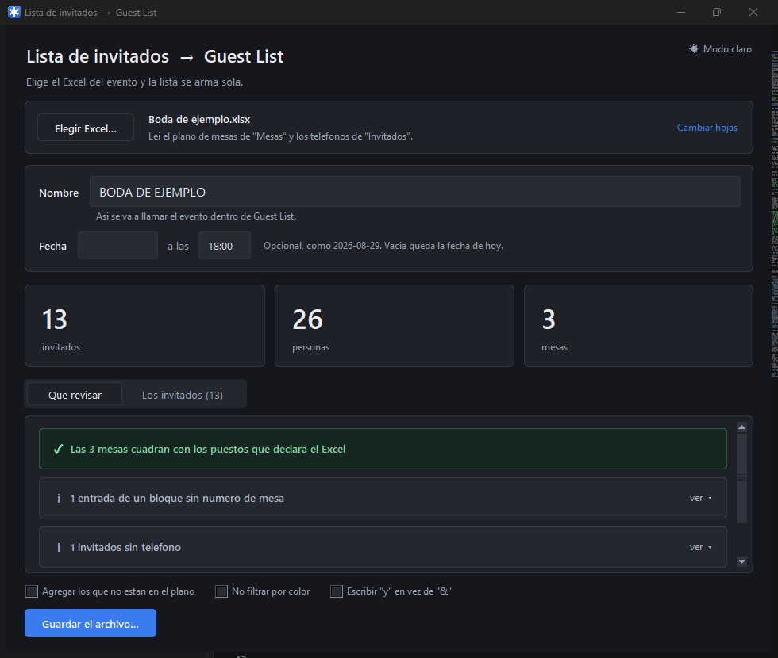
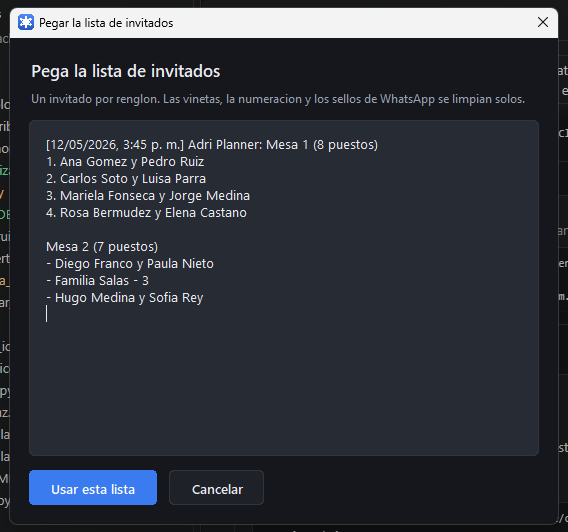

# Lista de invitados → Guest List

Convierte la lista de invitados de un Excel en el archivo `.glf` que abre la app
**Guest List** del iPad y el iPhone, para no tener que registrar los invitados uno por
uno a mano.



## Descargar

En la página de **[Releases](../../releases/latest)** está el archivo
**`Lista a Guest List.exe`**. Se descarga, se guarda donde sea (el Escritorio está bien)
y se abre con doble clic.

No hay que instalar nada: ni Python, ni Excel, ni conexión a internet.

> **La primera vez, Windows va a mostrar una pantalla azul** que dice *"Windows protegió
> su PC"*. Sale porque el programa no está firmado digitalmente, no porque tenga algo
> malo. Se toca **Más información** → **Ejecutar de todas formas**. Solo pasa la primera vez.

El programa **avisa solo cuando hay una versión nueva**: sale un aviso arriba con un
botón que lleva a la descarga. Si no hay internet no pasa nada, sigue funcionando igual.

## Cómo se usa

1. **Elegir Excel…** y escoger el archivo del evento. La lista aparece sola. Si la lista
   llegó por WhatsApp en vez de en un Excel, **Pegar texto…** hace lo mismo.
2. Revisar el **nombre del evento** — así se va a llamar dentro de Guest List — y, si se
   quiere, la fecha.
3. Mirar las dos vistas: **Qué revisar** dice lo que vale la pena mirar (mesas que no
   cuadran, quién quedó por fuera, quién no tiene teléfono), y **Los invitados** muestra
   la lista completa con su mesa y cuántas personas son.
4. **Guardar el archivo…** y mandarlo al iPad por WhatsApp, correo o AirDrop. En el iPad
   se toca el archivo → *Compartir* → **Guest List**.

También se puede arrastrar el Excel encima del programa para abrirlo directamente.

## Cuando la lista llega por WhatsApp

A veces no hay Excel: mandan la lista escrita en un mensaje. Para eso está
**Pegar texto…** — se pega tal cual y el programa la limpia.



Aguanta lo que la gente escribe de verdad:

| Lo que llega | Qué hace |
|---|---|
| `1. Ana Gómez y Pedro Ruiz` | Quita la numeración; cuenta 2 personas |
| `- Carlos Soto` · `• Luisa Parra` | Quita viñetas |
| `[12/05, 3:45 p. m.] Adri: Ana Gómez` | Quita el sello de WhatsApp |
| `Familia Salas - 5` · `Los Medina x4` | Toma el número del final como los cupos |
| `Familia Guzmán (4)` | Igual, entre paréntesis |
| `Mesa 1 (8 puestos)` y debajo los nombres | Asigna la mesa y comprueba que cuadre |

Si el texto no trae mesas, todos los invitados entran sin mesa y se las puede poner
después en Guest List. Todo lo demás —contar personas, niños, comprobar los cupos contra
lo que declara cada mesa— funciona igual que con un Excel.

El programa viene en modo oscuro; el interruptor de arriba a la derecha lo cambia, y
recuerda la elección y el tamaño de la ventana para la próxima vez.

## De dónde saca los invitados

**Cada evento llega con un Excel distinto**, porque cada quien lo arma a su manera. Lo
único que aparece siempre es la hoja del **plano de mesas**, así que esa es la fuente
principal: **cada renglón del plano es una entrada de Guest List**, tal como se registra
a mano en la app. `Ana Gómez y Pedro Ruiz` es **una** entrada con **+1 acompañante**, no
dos invitados.

Para contar las personas de cada renglón separa por `y`, `e`, `&`, comas y barras (en
mayúscula o minúscula), ignora lo que no es una persona ("Sra.", "pareja", "hijo",
"familia") y descarta los paréntesis. Si el plano trae columnas con números al lado del
nombre, esos mandan sobre el conteo.

### Formatos de plano que entiende

```
MESA 1  (9 PUESTOS)      MESA 2 (9 PUESTOS)     <- encabezados en varias columnas,
ANA GOMEZ Y ...          MARIELA                   los invitados debajo de cada uno
CARLOS SOTO Y ...        LUISA PARRA

Mesa 1 ( 11 puestos )  Adulto  Niños  Capitan   <- los cupos en columnas aparte
Sr Jorge Medina          2
Sr Hugo Salas            2       1

Mesa #1                                         <- la capacidad al pie en vez del
Marta Diaz & Julian Ortiz                          encabezado
...
Total: 11
```

Un bloque puede llamarse `NOVIOS (2)` en vez de `MESA n`: sus invitados entran sin número
de mesa.

> **Comprobación automática:** suma las personas de cada mesa y las compara con los
> puestos que el propio Excel declara (`(9 PUESTOS)`, `( 10 personas )`, `Total: 11`). Si
> alguna no cuadra, lo dice con el número de mesa. También avisa si un encabezado de mesa
> aparece repetido.

### La hoja de contactos es opcional

Si el archivo trae además una hoja con la lista de invitados, se usa para dos cosas:

1. Traer el **teléfono, email y observaciones** de cada entrada del plano, cruzando por
   nombre. El cruce aguanta tildes, títulos, apellidos incompletos y errores de tipeo, y
   respeta que un renglón compartido (`Gustavo Pardo y Lourdes Vega`) corresponda a dos
   filas de la lista.
2. Avisar quién está en esa hoja **pero no en el plano**.

> **El plano manda.** Suele ser lo último que arman los novios, así que quien no aparece
> ahí lo más probable es que ya no vaya, no que le falte mesa. Por eso esos nombres **no
> entran** a la lista: solo se enumeran para que uno decida. Si alguno sí va, se marca la
> casilla *"Agregar los que no están en el plano"* y entran sin mesa, con una nota que lo
> dice.

Si la hoja de contactos usa colores para marcar quién va (verde = confirmado), solo se
toman las filas verdes, y dice cuántas descartó de cada color. **Si no usa colores, se
toman todas.**

En los dos desplegables de *Cambiar hojas* se puede elegir `(ninguna)` cuando el archivo
no trae esa hoja, o corregir a mano si el programa adivinó mal.

### Columnas que reconoce

Por el encabezado, sin importar el orden ni las mayúsculas:

| Columna del Excel | Va a |
|---|---|
| Invitados / Nombre / Familia | Nombre |
| Cupos / Pax / Puestos / Adultos | Acompañantes = cupos − 1 (si no hay plano) |
| Niños | Nota "N niños" |
| Número de contacto / Teléfono / Celular | Teléfono |
| Contacto / Capitán | Nota "Contacto: …" |
| Email / Correo | Email |
| Confirman / Confirmados | Confirmado sí/no |
| Mesa / Ubicación | Mesa |
| Notas / Observaciones | Notas |

## No usa inteligencia artificial

Son reglas fijas: buscar patrones, partir texto, sumar y comparar. No consulta ningún
modelo y no aprende. **El mismo Excel siempre da el mismo resultado.**

**Los datos de los invitados nunca salen del computador.** Lo único que el programa manda
a internet es una pregunta a GitHub —"¿cuál es la última versión publicada?"— para avisar
si hay una nueva. Nada más, y si no hay red simplemente no pregunta.

Lo más parecido a algo "listo" es el cruce de nombres entre hojas, que usa
[`difflib`](https://docs.python.org/3/library/difflib.html) para medir qué tanto se
parecen dos palabras (así `Dayana` y `Daiana` se dan por iguales). Sigue siendo una
fórmula, no un criterio.

La consecuencia importante: si llega un Excel con una forma que no reconoce, **avisa que
no lo entiende** en vez de inventarse algo.

## Para trabajar en el código

```bash
pip install openpyxl pyinstaller

python app.py                    # abre la ventana
python construir_exe.py          # deja dist/Lista a Guest List.exe
```

También hay una versión de línea de comandos:

```bash
python excel_a_glf.py "Lista de Invitados.xlsx" --evento "NOMBRE DEL EVENTO" --fecha 2026-08-29
```

| Opción | Para qué |
|---|---|
| `--evento` | Nombre del evento = nombre del archivo `.glf`. |
| `--fecha` / `--hora` | Fecha del evento. Sin esto queda la de hoy. |
| `--hoja` | Hoja de contactos, o `(ninguna)`. |
| `--mesas` | Hoja del plano de mesas, o `(ninguna)`. |
| `--agregar-sin-mesa` | Agregar los de la hoja de contactos que no están en el plano. |
| `--todos` | No filtrar por color. |
| `--y` | Escribir `y` en vez de `&` en los nombres. |
| `--salida` | Ruta del `.glf` de salida. |

### Los archivos

| Archivo | Qué es |
|---|---|
| `app.py` | La ventana. |
| `interfaz.py` | Las piezas visuales redondeadas, dibujadas sobre lienzos. |
| `tema.py` | Las paletas de color y las preferencias guardadas. |
| `excel_a_glf.py` | La lógica: leer el Excel, cruzar mesas, armar los invitados. |
| `glf.py` | Lee y escribe el formato `.glf`. |
| `plantilla.glf` | Un `.glf` vacío, exportado por la app, del que sale la cabecera. |
| `plantilla_incrustada.py` | Esa cabecera y ese pie, incrustados. **Generado, no editar.** |
| `generar_plantilla.py` | Regenera lo anterior desde `plantilla.glf`. |
| `actualizacion.py` | Avisa si hay una versión nueva publicada en GitHub. |
| `construir_exe.py` | Empaqueta todo en el `.exe`. |
| `Convertir.bat` | Arrastrar y soltar, para quien tenga Python instalado. |

## Sobre el formato .glf

Es XML plano en UTF-8 sin BOM, con saltos de línea LF e indentación con tabuladores. Cada
invitado es un `<Guest>` con un ID único, banderas (`Invited`, `Confirmation`, `Arrived`,
`Child`, `Man`), `OtherGuestsCount` (los acompañantes) y cuatro secciones de campos:
nombre, teléfono/email, mesa y notas. Los campos vacíos se escriben `(null)`.

El nombre del evento **no viaja dentro del archivo** — la app lo toma del nombre del
archivo. Para renombrar un evento, basta renombrar el `.glf`.

La cabecera (los `ReportFields` y `DefaultFields`, que definen qué campos maneja el
evento) se copia tal cual de un `.glf` exportado por la propia app, para que la app lo
reconozca sin discutir. Comprobado: al releer un `.glf` y volverlo a escribir, el
resultado sale idéntico línea por línea, salvo espacios sobrantes al final de algunos
nombres que se limpian a propósito.

**Si algún día la app cambia el formato:** exportar un evento desde Guest List, guardarlo
como `plantilla.glf`, correr `python generar_plantilla.py` y volver a construir el `.exe`.
